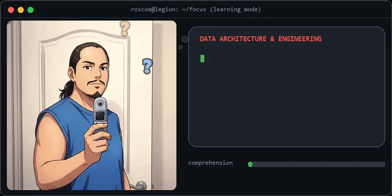

# Hi, I'm Roscoe Sincero 👋

I design SQL Server databases by day, and tinker with AI tools and old game engines by night. I talk to AI models so you don't have to.

> *Some AI agents come into our lives and quickly go. Some stay for a while, write thousands of lines of code we don't understand, break things that worked yesterday and we are never, ever the same.*
>
> *As a vibe coder, I work 12-hour shifts pressing Enter. My AI has the intelligence. I have the carpal tunnel.*

<details>
<summary>🤖 <b>More AI agent wisdom</b></summary>

> *Some AI agents are just passing ships in the night. Others linger just long enough to gaslight your entire test suite, seduce your CI/CD pipeline, delete the database migration scripts, and leave you staring at a terminal prompt wondering where your life went wrong.*
>
> *Some AI agents touch three lines and leave. Others open a PR titled "chore: simplify date formatting", touch 84 files across seven newly invented abstraction layers, wrap a single boolean in three nested generic interfaces, break the login screen in every timezone west of Greenwich, and leave 412 unit tests that all assert true === true*
>
> *Some AI agents submit modest bug fixes. Others open "fix: typo in README" that somehow includes an updated package manifest adding 1,400 npm modules, deprecates your build pipeline, migrates the ORM to a pre-alpha dialect, and leaves a PR comment assuring you: "All changes are purely cosmetic and safe to squash-merge."*

</details>

---

## 🛠️ Tech Stack & Tooling

<p align="center">
  <picture>
    <source media="(max-width: 600px) and (prefers-color-scheme: dark)" srcset="assets/tech-stack-dark-mobile.svg">
    <source media="(max-width: 600px)" srcset="assets/tech-stack-light-mobile.svg">
    <source media="(prefers-color-scheme: dark)" srcset="assets/tech-stack-dark.svg">
    
  </picture>
</p>

---

## ⚡ What I Focus On Today

<p align="center">
  <picture>
    <source media="(max-width: 600px)" srcset="assets/focus-mobile.webp">
    
  </picture>
</p>

* **Data Architecture & Engineering:** High-performance T-SQL, system-versioned temporal history tables, complex audit tracing, and enterprise-grade relational patterns.
* **Agentic Workflows & Model Steering:** Designing structured JSON schemas, running local LLM tools, and eliminating boilerplate through prompt-driven workflows.
* **Pragmatic Full-Stack Web:** Backend-rendered HTML fragments and reactive client UI via ASP.NET Core MVC, HTMX, Alpine.js, and Tailwind CSS.

---

## 🕹️ Retro Roots: Quake & Quake II (1996–1998)

Long before architecting modern data backends and steering LLMs, I spent the late 1990s deep in the id Software modding scene under the handle **Legion**, building autonomous bot AI, movement libraries, and total combat overhauls:

* **Stroggs Gone Mad (SGM)** *(Quake II, Nov 1998 — v1.0c)*:  
  A complete single-player combat and difficulty overhaul that cures the "turret syndrome" of vanilla Strogg units.

  <details>
  <summary><b>Features, downloads &amp; how to run it today</b></summary>

  * **Evasive Combat Maneuvers:** Re-engineered monster movement to include active lateral strafing, dodge mechanics, and dynamic positioning during fire cycles.
  * **Persistent Pursuit Logic:** Removed passive aggro limits, turning encounters into high-tempo hunts where enemies aggressively track players through geometry.
  * **Accelerated Attack Cycles:** Drastically reduced attack recovery intervals and increased projectile velocities to punish passive corner-camping.
  * **Downloads:** Available via [The Quake II Repository](https://thequake2repository.blogspot.com/2013/10/information-center.html) and [ModDB](https://www.moddb.com/games/quake-2/downloads).

  **🕹️ Running SGM on Yamagi Quake II / classic engines**

  Because SGM is a classic `gamex86.dll` mod, it runs natively on standard 32-bit source ports or vanilla-compatible 64-bit builds like [Yamagi Quake II](https://www.yamagi.org/quake2/):

  1. Download and extract the SGM archive (e.g., `sgm10c.zip`).
  2. Place the resulting folder (named `sgm` or `mad`) inside your root Quake II directory alongside `baseq2`.
  3. Launch via your modern port's command line or shortcut:
     ```bash
     yquake2.exe +set game sgm +map base1
     ```
     *(Or select the mod directly from the in-game mod menu if supported by your engine).*
  </details>

* **`norse_movetogoal` & Bot Navigation** *(Quake / QuakeC)*:  
  Custom movement, goal-seeking, and environment-awareness libraries built to overcome the navigation barriers of early QuakeC deathmatch bots. Widely adopted and credited across pioneer mod projects including *DoomBot*, *Paroxysm*, *SamBot*, and *UDM*.

* **Quake Bot Skeleton (`btsk`)**:  
  Reusable architectural foundations providing autonomous bot pathing, dynamic name generation, and water-level awareness for early community bot developers.
  
---

<p align="center">
  <i>"I'm here to vibe, not to transcribe."</i>
</p>
