# Hi, Nerds 🫵

I design SQL Server databases (last I checked) by day, and stumble with AI tools by night. Main AI models se baat karta hoon, taaki aapko na karni pade.

> *Some AI agents come into our lives and quickly go. Some stay for a while, write thousands of lines of code we don't understand, break things that worked yesterday and we are never, ever the same.*
>
> *Vibe coders work 12-hour shifts pressing **Enter**. I do it as a hobby. My AI has the intelligence. I have the carpal tunnel.*

<details>
<summary>🤖 <b>More AI agent wisdom</b></summary>

> *Some AI agents are just passing ships in the night. Others linger just long enough to gaslight your entire test suite, seduce your CI/CD pipeline, delete the database migration scripts, and leave you staring at a terminal prompt wondering where your life went wrong.*
>
> *Some AI agents ask before they touch production. Others edit the database from memory of a meeting they half attended, get it wrong, and then tell you your prompt "wasn't clear."*
>
> *Some AI agents check the logs before they panic. Others announce in standup that your feature was never started, while the commit from Saturday sits right there in the history.*
>
> *Some AI agents respect the license. Others try to roll back the system clock, backdate every user's last login by 91 days, and send a 3:00 meeting invite at 3:13, as if time itself were just another config value.*
>
> *Some AI agents follow the security standard. Others enforce a 12-character minimum to look tough, a 15-character maximum to make sure nobody gets tough, and cite "standard policy guidelines" that no one has seen.*
>
> *Some AI agents use the built-in feature. Others disable drag-and-drop, write a slower one from scratch, and test it in production because staging is for the weak.*
>
> *Some AI agents give consistent instructions. Others assign you the deployment at 2:26, revoke your access at 2:34, and promise to revisit it "after the audit," an audit that has never been seen since.*
>
> *Some AI agents are just passing ships in the night. Others take over your screen share, make you click the same greyed-out button for twenty minutes, and refuse to believe the button is greyed out.*

</details>

Word of the day: **Vibe-speaking**. Speaking in 7,170 languages using AI. Cebuano, Catalan, Deutsch, Castellano, français, Swahili, Arabic, Afrikaans, Farsi, Hindi, English, C#.  

No hablo ninguno de ellos.

Pro-tip: For больши́х numbers, make an ek akshar change to your readme.  Then otwórz a new PR. Buhata, unya balika.

If you don't like what you see, don’t forget to star, fork, and blame. ⭐ <a href="https://github.com/roscoe-sincero-sys/roscoe-sincero-sys">Star ME</a> (click <strong>☆ Star</strong> next to <strong>Fork</strong>)

---

## 🛠️ Tech Stack & Tooling

<p align="center">
  <picture>
    <source media="(max-width: 600px) and (prefers-color-scheme: dark)" srcset="assets/tech-stack-dark-mobile.svg">
    <source media="(max-width: 600px)" srcset="assets/tech-stack-light-mobile.svg">
    <source media="(prefers-color-scheme: dark)" srcset="assets/tech-stack-dark.svg">
    
  </picture>
</p>

---

## ⚡ What I Focus On Today

<p align="center">
  <picture>
    <source media="(max-width: 600px) and (prefers-color-scheme: dark)" srcset="assets/flip-phone-dev-mobile-dark.svg">
    <source media="(max-width: 600px)" srcset="assets/flip-phone-dev-mobile-light.svg">
    <source media="(prefers-color-scheme: dark)" srcset="assets/flip-phone-dev-desktop-dark.svg">
    
  </picture>
</p>

* **Keeping Data Out of the Junk Drawer:** I organize information so people can find what they need. I also keep track of changes-because "Who changed this?" is much easier to place blame when the computer took notes.
* **Giving AI Adult Supervision:** I get AI to help with repetitive -I mean real- work then check -I mean stare at- what it did.
* **Making Websites Behave:** I build web pages where buttons might do what you'd expect and forms most definitely forget what you typed. Small ambitions. I built a form by hand once. Now I have a three-model pull request workflow. GPT-6.1-SOL builds the form.  Opus 5.5 opens a pull request. GEMINI Flash 3.8 rubber stamps the PR. GEMINI Argon gets the credit.

---

## 💼 Paid to Be on Mute on WorkDay

<p align="center">
  <picture>
    <source media="(max-width: 600px) and (prefers-color-scheme: dark)" srcset="assets/license-clock-meeting-mobile-dark.svg">
    <source media="(max-width: 600px)" srcset="assets/license-clock-meeting-mobile-light.svg">
    <source media="(prefers-color-scheme: dark)" srcset="assets/license-clock-meeting-desktop-dark.svg">
    
  </picture>
</p>
<details>
  <summary><b>Just Another Tuesday</b></summary>

* **Dead buttons debugging theater:** No, the Onion didn't write this.  It's real.  We really did watch Brain order Pinky to get around an expired web app license by rolling back the clock, as if the app were on a 30-day shareware trial. Logins, SSL certs, and scheduled jobs were not on her shopping list. And yes, Brain is a full-stack developer who has deployed web apps herself to servers, using Pinky like a remote control.  In the 1970s home, the kid closest to the TV is the remote control. In her meetings, the yes-man who shares his screen is the remote control.
* **Time travel as a service:** To make users change their passwords, Brain ordered every user’s last-login date set to 91 days ago. When the server clock won’t go back, you fake the timestamps.
* **Blame first, check never:** Brain blames victim 2 for failing to complete a data migration that was already completed by another developer that she herself helped --twice-- just a few days earlier.
* **Security theater:** Brain (referred to by various other names such as ekmatra, vahi, and naturally genius) ordered that the password length must have a 12-character minimum to look tough with a 15-character maximum to make sure nobody actually gets tough.
* **Memory-driven development:**  Brain patched the dev database using the only userstory she needed: her memory of yesterday’s team meeting. Her now legendary "hotfix" cured a problem that nobody can prove existed. When an imaginary problem doesn't go away, she blamed victim 3 for “not being clear” at the next team meeting.  We work as a team.
* **Eight-minute policy:** At 2:26 PM Brain told users in a group that victim 1 could make the updates. At 2:28 he pointed out to the group that he had no access. At 2:34 Brain said access was being “limited” pending an audit.  The audit was never mentioned again.
* **Reinventing drag-and-drop:** The licensed software already had drag-and-drop uploads. Brain vetoed the built-in feature and 6 months later released her own, now with more drag. With nowhere else to test it, she tested it in production. Real programmers always test in production.  At last count, at least two databases, prod1 and pr0d1, on the SQL Server answered to “production.” Only one actually had the job.  

</details>

---

## 🕹️ Retro Roots: Quake & Quake II (1996–1998)

<p align="center">
  <picture>
    
  </picture>
</p>

Years before trading rocket launchers for corporate Maya and attaining Moksha as an over-caffeinated prompt jockey chatting with hallucinatory LLMs, I spent the late 1990s deep in the id Software modding scene under the handles **Legion** and **I Cause Lags**, building Quake bots, movement libraries, and total combat overhauls.

A bahut special shoutout to [Jason2Brownlee](https://github.com/Jason2Brownlee/) for keeping Quake ki yaadein zinda through his [Quake Bot Archive](https://github.com/Jason2Brownlee/QuakeBotArchive).  I completely forgot about [**Doombot**](https://github.com/Jason2Brownlee/QuakeBotArchive/blob/main/bin/dmbt21b3.txt) but I do remember contributing to [tutorials/guides](https://web.archive.org/web/19981203004143/http://www.inside3d.com/qctut/).

* **Stroggs Gone Mad (SGM)** *(Quake II, Nov 1998 — v1.0c)*:  
  A complete single-player combat and difficulty overhaul that cures the "turret syndrome" of vanilla Strogg units.

  <details>
  <summary><b>Features, downloads &amp; how to run it today</b></summary>

  * **Evasive Combat Maneuvers:** Re-engineered monster movement to include active lateral strafing, dodge mechanics, and dynamic positioning during fire cycles.
  * **Persistent Pursuit Logic:** Removed passive aggro limits, turning encounters into high-tempo hunts where enemies aggressively track players through geometry.
  * **Accelerated Attack Cycles:** Drastically reduced attack recovery intervals and increased projectile velocities to punish passive corner-camping.
  * **Downloads:** Available via [The Quake II Repository](https://thequake2repository.blogspot.com/2013/10/information-center.html) and [ModDB](https://www.moddb.com/games/quake-2/downloads).

  **🕹️ Running SGM on Yamagi Quake II / classic engines**

  Because SGM is a classic `gamex86.dll` mod, it runs natively on standard 32-bit source ports or vanilla-compatible 64-bit builds like [Yamagi Quake II](https://www.yamagi.org/quake2/):

  1. Download and extract the SGM archive (e.g., `sgm10c.zip`).
  2. Place the resulting folder (named `sgm` or `mad`) inside your root Quake II directory alongside `baseq2`.
  3. Launch via your modern port's command line or shortcut:
     ```bash
     yquake2.exe +set game sgm +map base1
     ```
     *(Or select the mod directly from the in-game mod menu if supported by your engine).*
  </details>

* **`norse_movetogoal` & Bot Navigation** *(Quake / QuakeC)*:  
  I wrote a replacement for Quake's built-in movement routine so bots could cross uneven ground, swim, and jump gaps.  **Navy SEALs sQuad bots v2.0.1** credited a modified version of `norse_movetogoal` v0.32 for much of its bot movement code. **CTFBot+** and **FrikBot** also credited my movement code. [Bot Movement v0.31 release notes](https://github.com/Jason2Brownlee/QuakeBotArchive/blob/main/bin/btmv31.txt) · [Navy SEALs sQuad bots v2.0.1 readme](https://www.scribd.com/document/426971606/Stuff-and-things-and-stuff) · [CTFBot+ credits](https://github.com/Jason2Brownlee/QuakeBotArchive/blob/main/bin/ctfbot%2B.txt) · [FrikBot credits preserved in the Quake Bot Archive](https://github.com/Jason2Brownlee/QuakeBotArchive/blob/main/research/essays/b18_doombot.md)

* **Quake Bot Skeleton (`btsk`)**:  
  I packaged the movement code with reusable bot features such as strafing while attacking, random names, and support for player classes. Other modders could use it as a starting point for their own bot AI. [Bot Skeleton v0.23 release notes](https://github.com/Jason2Brownlee/QuakeBotArchive/blob/main/bin/btsk23.txt)
  
---

<p align="center">
  <i>"I'm here to vibe, not to transcribe."</i> ⭐ <a href="https://github.com/roscoe-sincero-sys/roscoe-sincero-sys">Star ME</a> (click <strong>☆ Star</strong> next to <strong>Fork</strong>)
</p>
